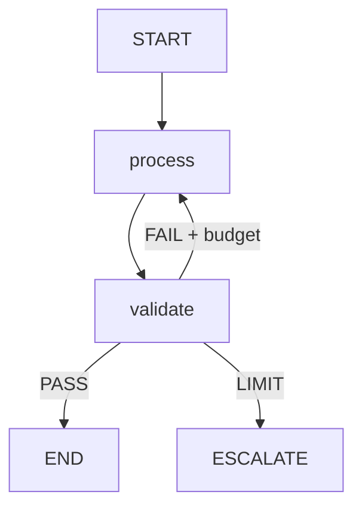

# AI Agent Architecture Specification

- Project / use case:
- Owner and deployment environment:
- Chosen topology (Chain / DAG / StateGraph) and reason:
- In-scope / out-of-scope:
- Critical external side effects:
- Threat model / trust boundaries:

## Graph diagram

## State model

Define typed fields with writer ownership and persistence policy. Include run ID, version, counters, budgets, immutable requirements, artifacts, approval and error classification.

## Nodes

| Node | Type | Input | Output | Side effect | Timeout | Error path |
|---|---|---|---|---|---|---|

## Transitions

| From | Condition (validated) | To | Global/local guard |
|---|---|---|---|

## Budget and termination

Explain hard global guards, local generation limit, no-progress handling, deadline, and model-call reservation.

## Validation

Separate deterministic, factual, semantic validation with evidence sources and decision policy.

## Persistence and effects

Checkpoints, concurrent reducers, operation ID, ambiguity reconciliation and approval bindings.

## Test plan

At minimum: invalid JSON, API 429, generation limit, crash/restart, lost ACK, duplicate webhook, stale approval.

## Known assumptions and untested risks

Explicitly list.
